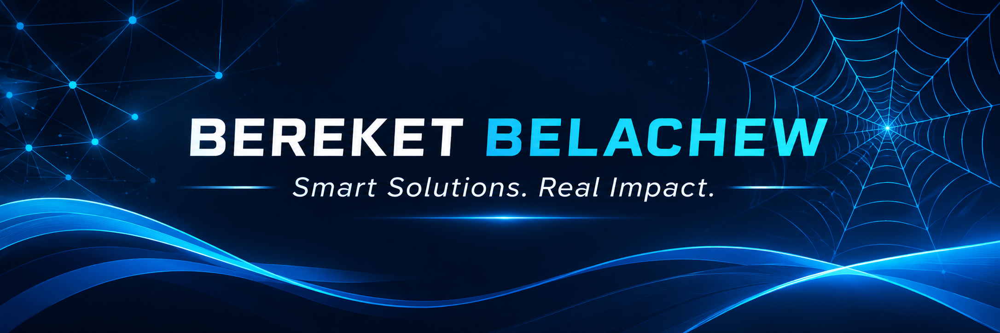

 

# BEREKET BELACHEW

### Full-Stack Developer | Software Engineer | Digital Creator

**Smart Solutions. Real Impact.**

I design and develop modern digital products that solve real-world problems. I enjoy transforming ideas into functional applications through software engineering, creative thinking, and modern technology.

---

## 👨‍💻 About Me

I'm Bereket Belachew, a developer passionate about building useful, modern, and scalable software solutions.

My development interests include:

- Full-stack web application development.
- Cross-platform mobile application development.
- Backend systems and database architecture.
- Modern UI/UX design.
- Business-oriented digital solutions.
- Secure and maintainable software engineering.

I believe great software combines functionality, simplicity, performance, and excellent user experience.

## 🛠️ Technology Stack

**Frontend & Mobile**

**Backend & Database**

**Development Tools**

## 🚀 Selected Projects

### 01. HabeshaSpot

A project focused on helping people discover local businesses through digital technology.

**Focus areas:**
- Business discovery and search.
- Interactive maps.
- Business submissions and approval workflows.

[Explore Repository →](https://github.com/beky-251/habesha-spot)

### 02. Portfolio

My web development portfolio repository, where I organize and present digital work.

[Explore Repository →](https://github.com/beky-251/portfolio)

### 03. Aurora House

A web development project in my public repository collection.

[Explore Repository →](https://github.com/beky-251/aurora-house)

### Other Development Projects

I'm also developing ideas and applications around:

- Ethiopian and Gregorian calendar conversion.
- Multiplayer gaming experiences.
- QR-based restaurant menus and online ordering.
- Digital business solutions.

## 🎯 My Engineering Principles

| Principle | My approach |
|---|---|
| Simplicity | Build intuitive user experiences |
| Quality | Write maintainable code |
| Security | Protect application data |
| Innovation | Explore practical technologies |
| Growth | Learn and improve continuously |

## 📊 GitHub Statistics

## 🌐 Connect With Me

I'm open to connecting with developers, exploring ideas, collaborating on software projects, and building meaningful digital products.

- GitHub: [@beky-251](https://github.com/beky-251)
- Projects: [My repositories](https://github.com/beky-251?tab=repositories)

---

### SMART SOLUTIONS. REAL IMPACT.

**Building ideas into technology.**

*Think. Build. Improve. Repeat.*

